# CareerDesk MVP 技术方案

个人职业与项目工作台。打通「项目推进 → 经历沉淀 → 岗位匹配 → 定制简历」闭环。

需求见 [产品需求](requirements/product.md) 与 [开源交付需求](requirements/delivery.md)。界面以桌面原型 `career-workspace` 的三份 HTML 为准。公开后的交付物是 Git 仓库：使用者在本机启动，用浏览器打开本机地址。不提供安装包，也不提供作者托管的网站。

## 1. 结论

做成单人本地应用：Next.js 全栈、SQLite、服务端调用兼容 OpenAI 的模型。不设账号，不拆微服务，不用向量库。首次启动是空库；原型中的人物和项目放在 `fixtures`，经确认后才导入。数据库从第一版使用迁移。全量 JSON 可导出、可导回。未配置模型密钥时，记录、编辑和导出仍可用。

三条规则贯穿所有模块：

1. 事实、简历句、投递稿分成三层。项目「做了什么 & 证据」是唯一事实源；「简历描述」是提炼句；投递版纸面上改的字只属于该版本。
2. 状态为「计划中」的项目不能写成已达成结果。母版合并跳过它们；生成投递版时默认不勾选；AI 只输出「筹备中、尚未执行」一类句子。
3. 母版更新不覆盖投递版。合并只改 Master。投递版已有手工改写时保持不动，由用户决定是否拉入新句子。

原型相对需求多出来、必须进模型的内容：

| 原型有、需求实体表没有 | 落点 |
| --- | --- |
| 左侧栏、素材完整度、投递准备度 | 壳层组件；两个进度查询时计算，不入库 |
| 卡片摘要、技术标签、搜索 | `projects.summary`、`projects.tags` |
| 城市、薪资、部门、匹配分、关键词有无证据 | `job_targets` 与 `job_keywords` |
| 抬头、简介、技术栈、教育经历 | 单行表 `profile` |
| 项目时间段、团队、可编辑正文 | `resume_items` |
| 合并弹窗左右对比，计划中项目标为已忽略 | `sync_proposals` |

抽屉输入用纯文本 / Markdown 文本框，900ms 防抖自动保存。MVP 不做富文本编辑器。

## 2. 系统架构

浏览器只谈自己的 Next.js 服务。模型密钥留在服务端环境变量。SQLite 文件放在本机数据目录。

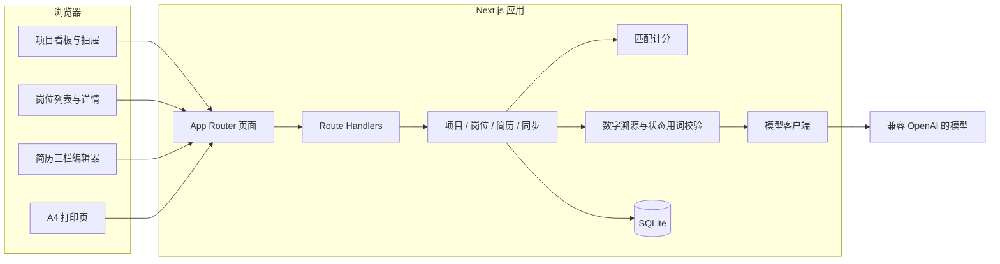

模块职责：

| 模块 | 职责 | 不负责 |
| --- | --- | --- |
| 页面 | 三页布局、抽屉、弹窗、自动保存状态文案 | 分数公式、提示词 |
| Domain | 状态迁移、母版唯一、投递版覆盖不回写 | HTTP 与提示词原文 |
| Match | 关键词命中、状态加权、岗位分 | 撰写匹配原因 |
| Guard | 校验模型 JSON；拒绝事实中不存在的数字 | 调用界面 |
| AI | 按固定 system prompt 请求模型 | 直接改数据库 |

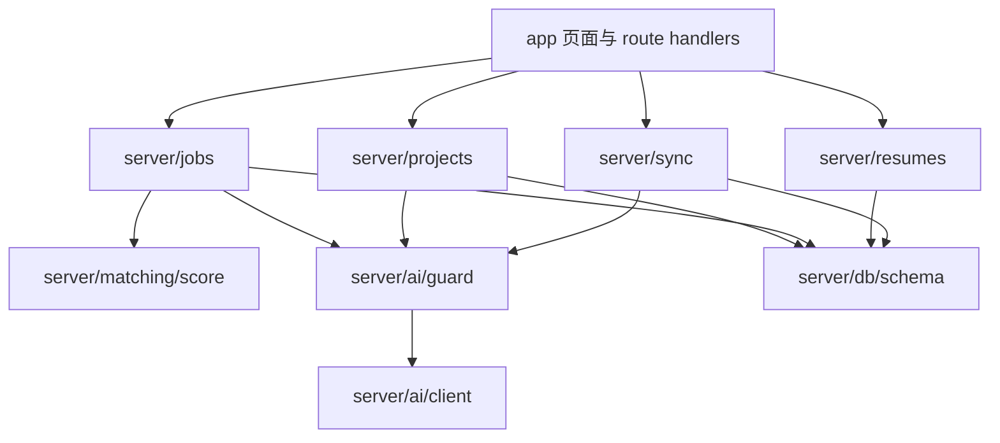

技术选型：

| 层 | 选择 | 原因 |
| --- | --- | --- |
| 应用 | Next.js App Router + TypeScript + Tailwind | 页面与接口同一仓库 |
| 数据 | SQLite + Drizzle migration | 单文件；升级走迁移，不要求删库 |
| 校验 | Zod | 接口入参与模型 JSON 共用 schema |
| 拖拽 | dnd-kit | 三列看板改状态 |
| PDF | 打印页 + `@page { size: A4 }` + `window.print()` | 与屏幕预览同一份 HTML |
| Markdown 导出 | 服务端按勾选项目拼接并下载 | 不经过模型 |
| 模型 | `OPENAI_BASE_URL` / `OPENAI_API_KEY` / `OPENAI_MODEL` | 可换 DeepSeek、通义等兼容接口。无密钥时使用不访问网络的假模型 |

打印页达不到版式要求时，再对同一路由加 Puppeteer。在此之前不引入无头浏览器。

## 3. 信息架构

原型是左侧栏，不是需求文档里的顶部三个 Tab。实现跟随原型。

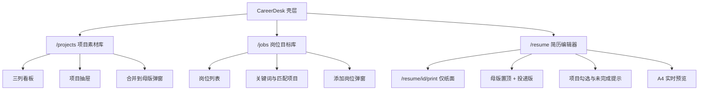

视觉取自原型：品牌色 `#2f6bff`，页面底 `#f4f6fa`，警告 `#b98217` / `#fffaef`，完成绿 `#0d8a6c`。项目页与岗位页侧栏宽 228px，简历页侧栏宽 212px。

侧栏两个进度都是派生值：

- 素材完整度 = 已写事实且没有待补问题的项目数 / 项目总数
- 投递准备度 = 已生成投递版的岗位数 / 岗位总数

## 4. 数据模型

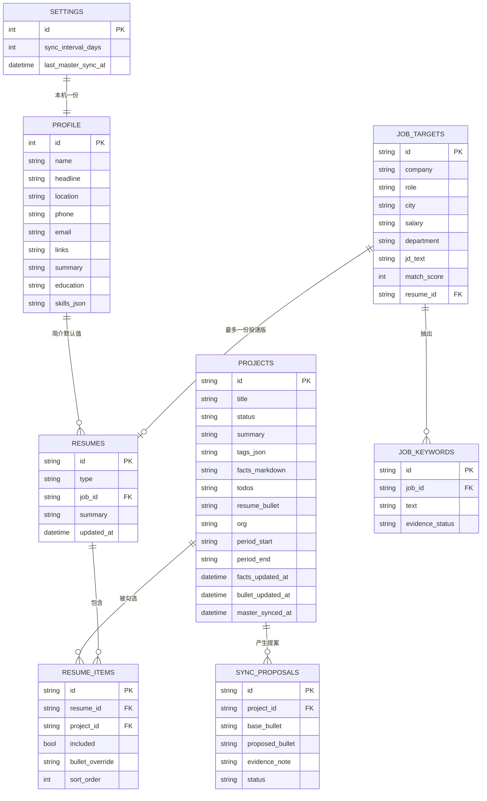

状态枚举存英文，界面显示中文：`planned` 计划中，`active` 进行中，`done` 已完成。

`resumes.type` 为 `master` 或 `targeted`。数据库保证 `type = 'master'` 只有一行。一个岗位最多一份投递版，再次生成时打开已有版本。

`resume_items.bullet_override` 为空时，预览读 `projects.resume_bullet`。纸面上的修改只写 override。

`job_keywords.evidence_status`：`supported` 表示标签、事实或简历句中能找到原文；`gap` 表示找不到。这只说明素材库里有没有这句话，不说明能力是否真实存在。

`sync_proposals.status`：`pending`、`accepted`、`dismissed`、`rejected`。`rejected` 表示模型输出没通过溯源校验，不能确认合并。

项目状态机：

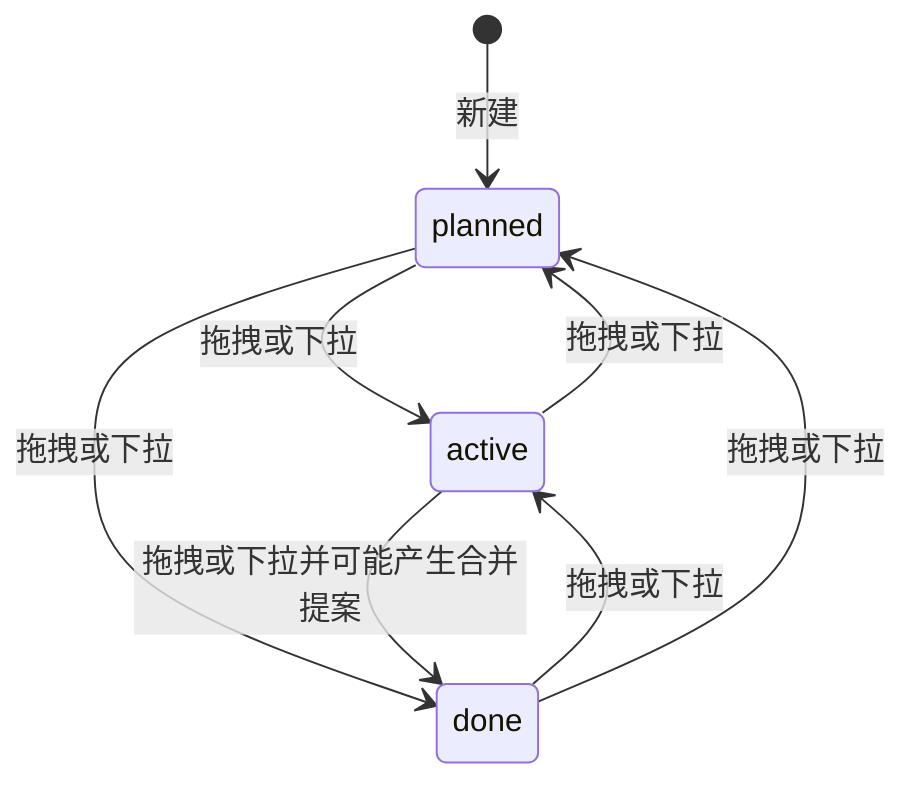

三层文本的数据流：

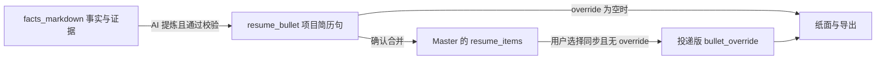

## 5. 领域规则

匹配分 0–100，由规则计算，不由模型直接给出百分比。

单条关键词对单个项目：

- 出现在标签、事实或简历句中，记基础命中。
- 状态加权：已完成 1.0，进行中 0.7，计划中 0.35。
- 事实中含有数字证据时再加一档。

岗位分是加权后的关键词命中率。已完成项目的权重大于进行中。展示颜色与原型一致：80 分及以上绿色，65–79 黄色，低于 65 灰色。

只把相关度最高的 2～3 个项目交给模型写匹配原因，原因必须引用事实原句。计划中项目可以出现在列表中，生成投递版时默认不勾选。

简历句校验，任一失败则拒绝写入：

- 输出中的数字必须能在 `facts_markdown` 中找到原文。百分数若由原文差值算出，必须能由原文中的两个数复核。
- `planned` 只允许「筹备 / 计划中 / 尚未执行」，不允许结果句。
- `active` 必须出现「进行中」，不能把灰度或联调写成已全量上线。

所有生成简历描述的 system prompt 固定包含：

> 仅基于提供的事实和证据进行提炼，严禁编造未提及的数据，严禁将「计划中」的事项描述为已达成的结果。

`settings` 全局一行。`sync_interval_days` 默认 7。打开应用时用它和 `last_master_sync_at` 判断是否检查合并，不绑定星期几。该行随全量 JSON 导出。

母版合并触发：

- 卡片拖入「已完成」，且 `facts_updated_at` 晚于 `master_synced_at`。
- 打开应用时，距 `last_master_sync_at` 超过 `sync_interval_days`，且存在事实更新。
- 生成提案时排除 `planned`。横幅文案：「检测到 X 个项目有新进展，是否更新到经历母版？」
- 确认合并只更新 Master 上对应项目的句子，写下项目的 `master_synced_at`，并刷新 `settings.last_master_sync_at`。
- 已有 `bullet_override` 的投递版保持原句，版本列表显示「母版有更新」。

## 6. 业务流程

### 6.1 日常记录

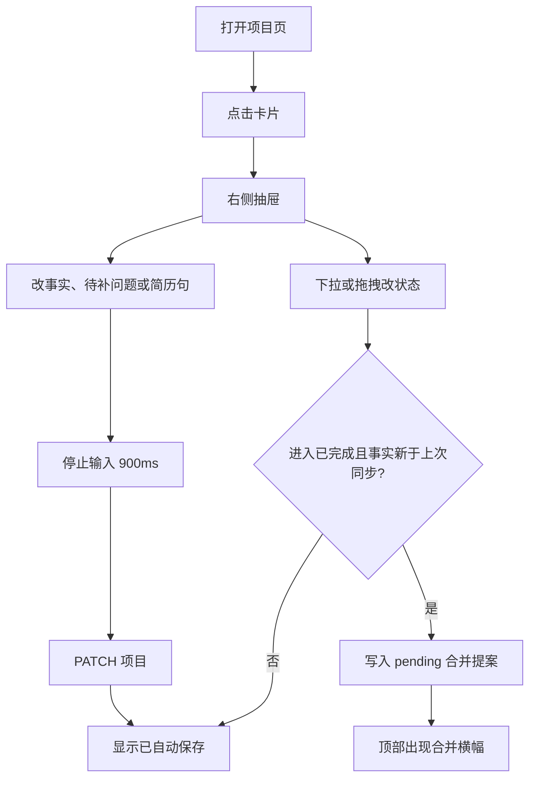

### 6.2 母版合并

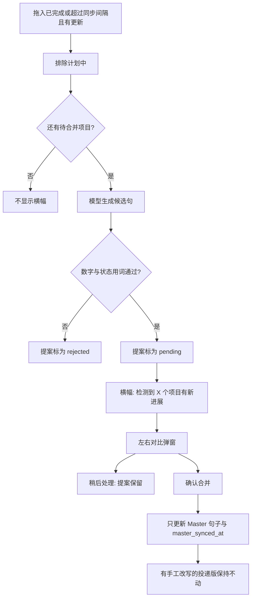

### 6.3 针对岗位出简历

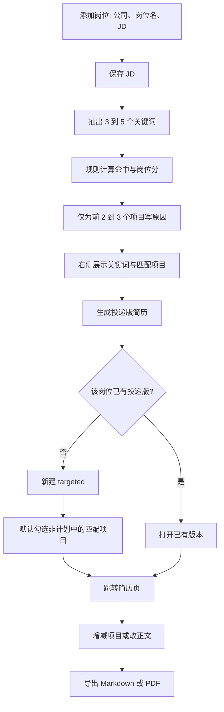

勾选进行中或计划中项目时，复选框旁显示：「该项目尚未完成，建议在简历中标注进行中或仅作技术栈展示」。

## 7. 时序

### 7.1 抽屉自动保存

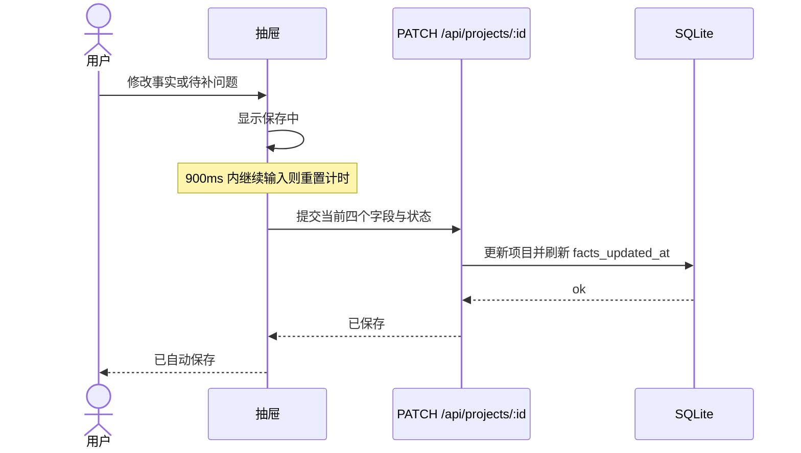

### 7.2 AI 提炼简历句

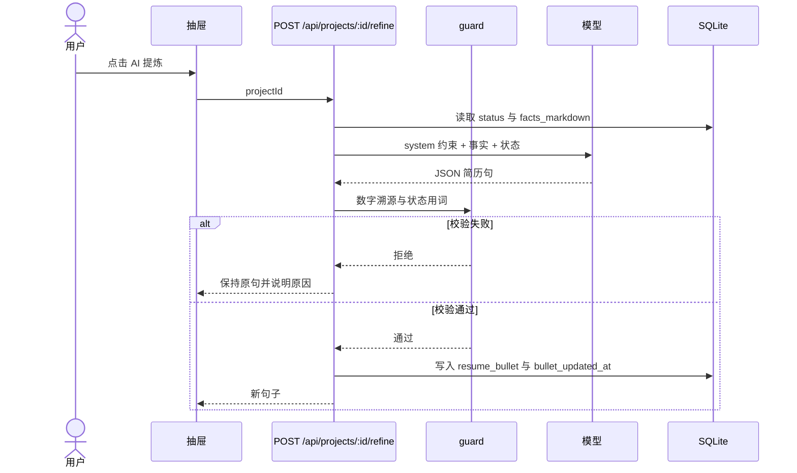

计划中项目不请求成果型描述。服务端直接采用「筹备《标题》（计划中，尚未执行）」这类模板，避免模型把计划写成结果。

### 7.3 保存岗位并匹配

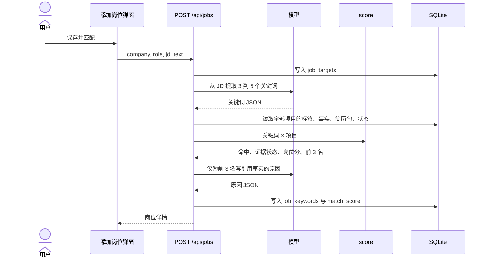

「重新提取」走 `POST /api/jobs/:id/analyze`，步骤与上图从抽词开始相同。

### 7.4 生成投递版

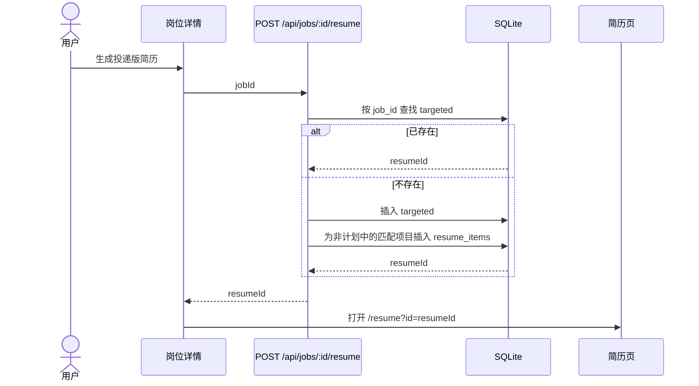

### 7.5 确认合并母版

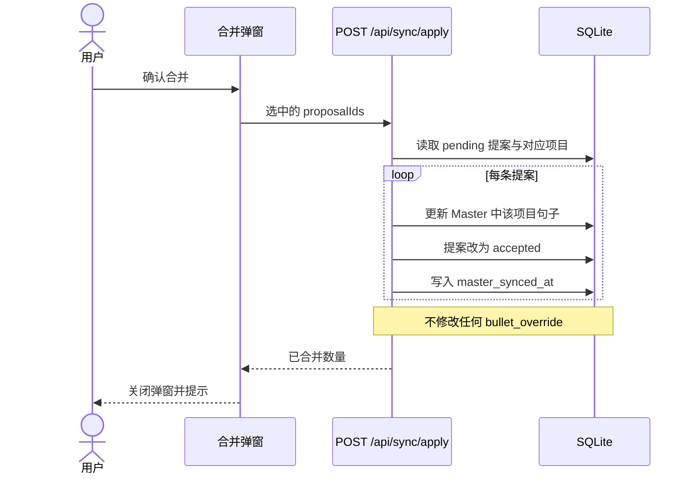

### 7.6 导出

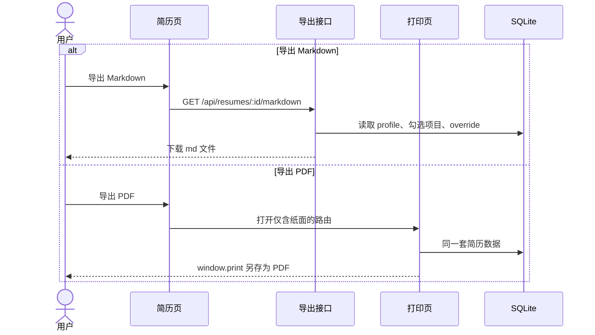

Markdown 与 PDF 使用同一选择结果：未勾选的项目不出现；有 override 时用 override，否则用项目简历句。

## 8. 接口

| 动作 | 接口 | 行为 |
| --- | --- | --- |
| 改项目 | `PATCH /api/projects/:id` | 状态、事实、待补问题、简历句。进入已完成且事实更新时创建合并提案 |
| AI 提炼 | `POST /api/projects/:id/refine` | 通过校验后写入 `resume_bullet`，不改母版 |
| 保存岗位 | `POST /api/jobs` | 存 JD，接着抽词与匹配 |
| 重新提取 | `POST /api/jobs/:id/analyze` | 刷新关键词、分数、原因 |
| 生成投递版 | `POST /api/jobs/:id/resume` | 已有则返回现有 id |
| 改简历 | `PATCH /api/resumes/:id` | 勾选与 override。母版纸面不可编辑 |
| 合并 | `POST /api/sync/apply` | 接受的提案写入 Master |
| 同步检测 | `GET /api/sync/pending` | 横幅与弹窗数据 |
| 导出简历 | `GET /api/resumes/:id/markdown` | 下载当前版本 `.md` |
| 全量备份 | `GET /api/backup` | 下载档案、项目、岗位、简历、提案与设置的 JSON |
| 导回备份 | `POST /api/backup` | 在空库或经确认后写入 JSON |
| 示例数据 | `POST /api/demo` | 写入 `fixtures` 中的虚构数据；库非空时要求确认 |
| 设置 | `GET /api/settings`、`PATCH /api/settings` | 读取或修改同步间隔 |

## 9. 目录

```text
src/app/(workspace)/projects/page.tsx
src/app/(workspace)/jobs/page.tsx
src/app/(workspace)/resume/page.tsx
src/app/resume/[id]/print/page.tsx
src/app/api/...
src/components/shell/Sidebar.tsx
src/components/projects/Board.tsx
src/components/projects/ProjectDrawer.tsx
src/components/projects/MergeDialog.tsx
src/components/jobs/JobList.tsx
src/components/jobs/JobDetail.tsx
src/components/jobs/AddJobDialog.tsx
src/components/resume/VersionList.tsx
src/components/resume/ProjectPicker.tsx
src/components/resume/Paper.tsx
src/server/db/schema.ts
src/server/db/migrations/
src/server/projects.ts
src/server/jobs.ts
src/server/resumes.ts
src/server/sync.ts
src/server/backup.ts
src/server/ai/client.ts
src/server/ai/fake.ts
src/server/ai/prompts.ts
src/server/ai/guard.ts
src/server/matching/score.ts
src/content/zh-CN.ts
src/styles/print.css
fixtures/demo.json
```

界面中文句子放在 `src/content/zh-CN.ts`。模型客户端在无 `OPENAI_API_KEY` 或 `AI_PROVIDER=fake` 时使用 `fake.ts`，不发网络请求。SQLite 路径为 `DATA_DIR` 下的数据库文件。

## 10. 实施顺序

每一阶段结束都能单独使用。

1. **空库与迁移。** Drizzle migration、`DATA_DIR`、`.env.example`、空白母版。验收：新环境启动后没有虚构人物。
2. **项目素材库。** 侧栏、三列看板、搜索、拖拽、抽屉与自动保存、空状态。验收：刷新后事实仍在；拖入已完成时列计数与状态颜色更新。
3. **简历编辑器，先不接模型。** 档案、唯一母版、投递版、勾选、纸面、未完成提示、Markdown 与打印导出、全量 JSON。验收：改投递版一句话，母版与其他岗位版本不变；JSON 导回后改写仍在。
4. **岗位匹配。** 添加岗位、抽词、规则计分、2～3 个项目及原因、证据勾与三角、无密钥时的不可用说明。验收：计划中项目可出现在匹配列表，默认不进入简历。假模型下测试不访问网络。
5. **生成投递版。** 创建或打开该岗位唯一投递版，默认勾选非计划中的匹配项目，并跳到简历页。
6. **母版同步。** 可配置间隔（默认 7 天）、横幅、左右对比、计划中忽略、校验失败不可合并、确认只写 Master。
7. **仓库交付。** MIT 许可证、README（启动、原生模块、数据何时离开本机）、示例数据导入、持续集成中的领域测试。

自动化测试覆盖：状态加权、计划中排除、数字必须来自事实、母版唯一、投递版覆盖不回写项目简历句。测试数据使用 fixture，不把示例数据写成启动默认值。

## 11. MVP 不做

账号与多用户、作者托管的网站、安装包、Docker 镜像、遥测、向量检索、富文本、定时邮件、在线分享、多语言、在打印页够用之前引入 Puppeteer。侧栏底部只展示档案中的姓名，不做账户菜单。
